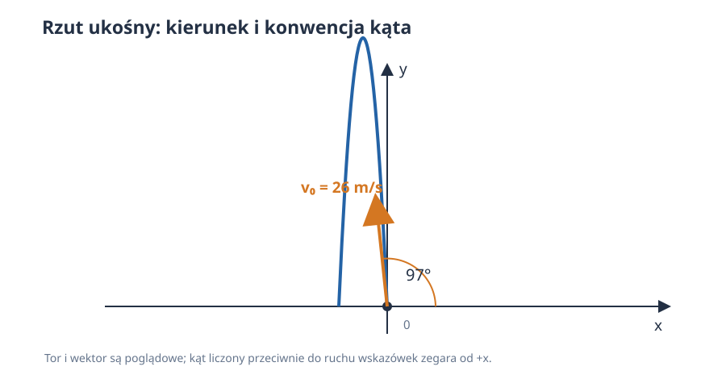
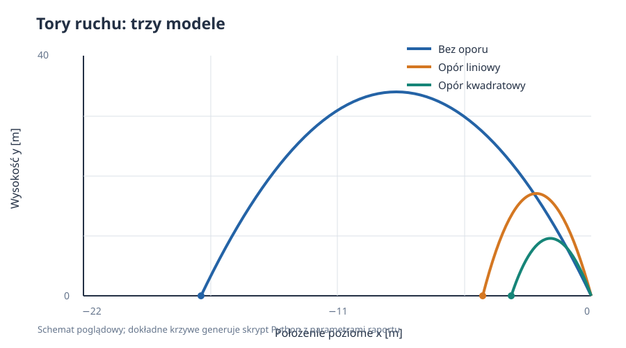
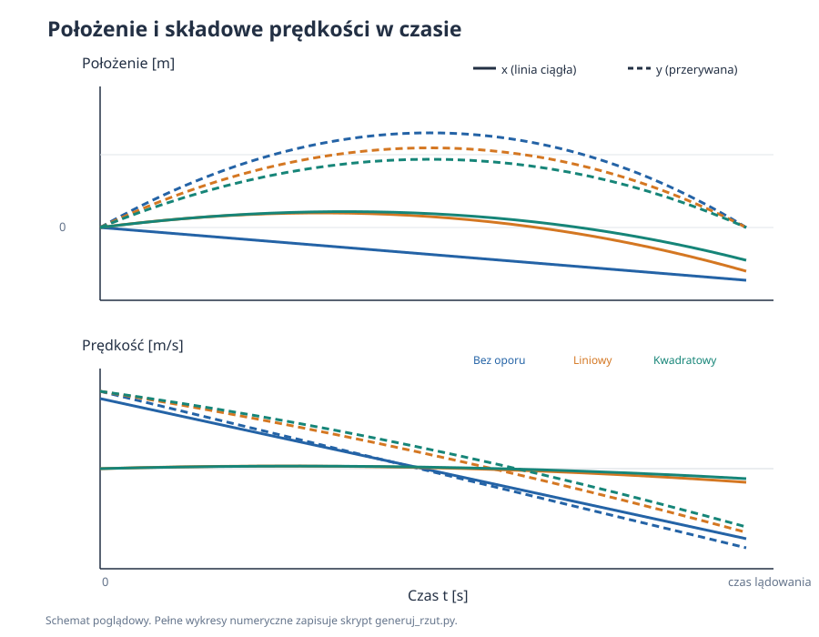
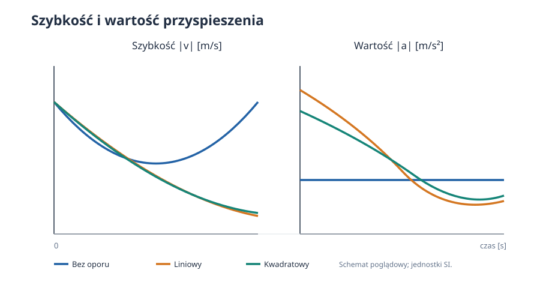
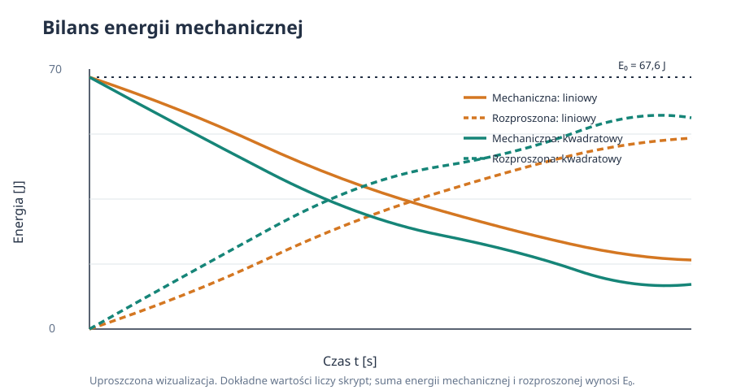
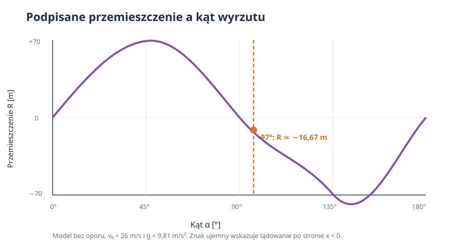

# Rzut ukośny — ruch bez oporu i z oporem powietrza

*Raport obliczeniowy: rozkład ruchu na składowe, rozwiązania analityczne, modelowanie oporu i symulacja numeryczna.*

**Dane zadania:** prędkość początkowa $v_0=26\,\mathrm{m/s}$, kąt $\alpha=97^\circ$.  
**Metoda:** wyprowadzenie równań ruchu i porównanie trzech modeli: bez oporu, z oporem liniowym i z oporem kwadratowym.  
**Charakter danych:** przykład modelowy; parametry oporu i masa są jawnie przyjętymi założeniami, nie wynikami pomiaru.

Rzut ukośny jest ruchem w dwóch wymiarach. Grawitacja zmienia składową pionową prędkości, a opór powietrza przeciwdziała chwilowej prędkości ciała. Zapis wektorowy porządkuje oba efekty, a rozkład na osie $x$ i $y$ pozwala obliczać położenie, prędkość, przyspieszenie, wysokość maksymalną, czas lotu i przemieszczenie poziome.

> **Uwaga o kącie:** kąt $\alpha$ mierzymy od dodatniego kierunku osi $x$, przeciwnie do ruchu wskazówek zegara. Ponieważ $97^\circ>90^\circ$, ciało początkowo wznosi się, ale leci w lewo. Wartość przemieszczenia poziomego przy lądowaniu będzie zatem ujemna.



*Rysunek 1. Układ współrzędnych i kierunek prędkości początkowej. Kąt liczony jest od dodatniej osi $x$.*

## Spis treści

1. [Cel, założenia i symbole](#1-cel-założenia-i-symbole)
2. [Rozkład prędkości początkowej](#2-rozkład-prędkości-początkowej)
3. [Rzut bez oporu powietrza](#3-rzut-bez-oporu-powietrza)
4. [Opór liniowy](#4-opór-liniowy)
5. [Opór kwadratowy i rozwiązanie numeryczne](#5-opór-kwadratowy-i-rozwiązanie-numeryczne)
6. [Porównanie modeli i energia](#6-porównanie-modeli-i-energia)
7. [Kod i odtwarzanie wykresów](#7-kod-i-odtwarzanie-wykresów)
8. [Jak wykonać doświadczenie](#8-jak-wykonać-doświadczenie)
9. [Wnioski](#9-wnioski)

---

## 1. Cel, założenia i symbole

Celem jest opisanie ruchu ciała wyrzuconego z poziomu $y=0$ zadaną prędkością i kątem. Najpierw rozpatrujemy model idealny, w którym działa tylko ciężar. Następnie dodajemy opór proporcjonalny do prędkości oraz opór proporcjonalny do kwadratu szybkości. Pozwala to odróżnić przypadek z prostym rozwiązaniem analitycznym od modelu, który w ogólności rozwiązujemy numerycznie.

### 1.1. Założenia

- Oś $x$ jest pozioma, a oś $y$ skierowana pionowo w górę.
- Przyspieszenie grawitacyjne jest stałe: $g=9{,}81\,\mathrm{m/s^2}$.
- Początek układu współrzędnych znajduje się w punkcie wyrzutu; poziom lądowania to $y=0$.
- Ziemię traktujemy jako płaską, a jej ruch i krzywiznę pomijamy.
- W modelu z oporem nie uwzględniamy wiatru; powietrze spoczywa względem układu odniesienia.
- Przyjmujemy masę $m=0{,}20\,\mathrm{kg}$. Do ilustracji oporu wybieramy $c=0{,}12\,\mathrm{kg/s}$ oraz $c_d=0{,}006\,\mathrm{kg/m}$. To parametry modelowe, nie uniwersalne własności ciała.

### 1.2. Symbole i jednostki SI

| Symbol | Znaczenie | Jednostka SI |
| :--- | :--- | :---: |
| $t$ | czas | $\mathrm{s}$ |
| $x,y$ | współrzędne położenia | $\mathrm{m}$ |
| $v_x,v_y, v$ | składowe prędkości i szybkość | $\mathrm{m/s}$ |
| $a_x,a_y$ | składowe przyspieszenia | $\mathrm{m/s^2}$ |
| $m$ | masa ciała | $\mathrm{kg}$ |
| $g$ | wartość przyspieszenia grawitacyjnego | $\mathrm{m/s^2}$ |
| $c$ | współczynnik oporu liniowego | $\mathrm{kg/s}$ |
| $c_d$ | współczynnik oporu kwadratowego | $\mathrm{kg/m}$ |
| $E$ | energia mechaniczna | $\mathrm{J}$ |

Kąt podano w stopniach, zgodnie z danymi zadania. W obliczeniach numerycznych funkcje trygonometryczne przyjmują radiany: $97^\circ=97\pi/180\,\mathrm{rad}\approx1{,}693\,\mathrm{rad}$.

## 2. Rozkład prędkości początkowej

Wektor prędkości początkowej ma wartość $v_0$ i tworzy kąt $\alpha$ z osią $x$. Jego składowe wynikają z definicji sinusa i cosinusa:

$$
v_{x0}=v_0\cos\alpha,
\qquad
v_{y0}=v_0\sin\alpha.
$$

Dla podanych danych:

$$
v_{x0}=26\cos(97^\circ)\approx-3{,}169\,\mathrm{m/s},
\qquad
v_{y0}=26\sin(97^\circ)\approx25{,}806\,\mathrm{m/s}.
$$

Kontrola: $\sqrt{v_{x0}^2+v_{y0}^2}=26\,\mathrm{m/s}$. Znak minus przy $v_{x0}$ oznacza początkowy ruch w lewo; dodatnie $v_{y0}$ oznacza wznoszenie.

## 3. Rzut bez oporu powietrza

### 3.1. Równania ruchu i ich całkowanie

Jedyną siłą jest ciężar $\vec{F}_g=(0,-mg)$. Z drugiej zasady Newtona:

$$
m\ddot{x}=0,
\qquad
m\ddot{y}=-mg,
$$

czyli:

$$
\ddot{x}=0,
\qquad
\ddot{y}=-g.
$$

Całkując i stosując warunki początkowe $x(0)=y(0)=0$, $\dot{x}(0)=v_{x0}$ i $\dot{y}(0)=v_{y0}$, otrzymujemy:

$$
x(t)=v_0\cos\alpha\,t,
\qquad
y(t)=v_0\sin\alpha\,t-\frac{1}{2}gt^2.
$$

Pochodne tych równań dają prędkość i przyspieszenie:

$$
v_x(t)=v_0\cos\alpha,
\qquad
v_y(t)=v_0\sin\alpha-gt,
$$

$$
a_x(t)=0,
\qquad
a_y(t)=-g.
$$

Składowa pozioma prędkości jest stała, a pionowa maleje liniowo. W najwyższym punkcie $v_y=0$, lecz $v_x$ nadal jest ujemne, więc ciało nie zatrzymuje się.

### 3.2. Wysokość maksymalna

Warunek wierzchołka toru to $v_y(t_h)=0$. Z równania prędkości:

$$
0=v_0\sin\alpha-gt_h
\quad\Longrightarrow\quad
t_h=\frac{v_0\sin\alpha}{g}.
$$

Podstawiając ten czas do $y(t)$:

$$
h_{\max}=y(t_h)
=\frac{v_0^2\sin^2\alpha}{2g}
\approx33{,}94\,\mathrm{m}.
$$

Czas wznoszenia wynosi około $2{,}630\,\mathrm{s}$. Przy braku oporu czas opadania z tej samej wysokości jest taki sam.

### 3.3. Czas lotu, tor i przemieszczenie poziome

Dla powrotu na wysokość początkową rozwiązujemy $y(t)=0$. Po wyłączeniu rozwiązania $t=0$:

$$
v_0\sin\alpha\,t-\frac{1}{2}gt^2=0
\quad\Longrightarrow\quad
T=\frac{2v_0\sin\alpha}{g}
\approx5{,}261\,\mathrm{s}.
$$

Aby otrzymać równanie toru, eliminujemy czas z $x(t)$: $t=x/(v_0\cos\alpha)$. Stąd:

$$
y(x)=x\tan\alpha-\frac{g x^2}{2v_0^2\cos^2\alpha}.
$$

Podstawienie $t=T$ do równania poziomego daje podpisane przemieszczenie do lądowania:

$$
R=x(T)=\frac{v_0^2\sin(2\alpha)}{g}
\approx-16{,}67\,\mathrm{m}.
$$

Wartość bezwzględna $|R|$ to odległość pozioma od miejsca wyrzutu, natomiast znak informuje, że punkt lądowania znajduje się po stronie $x<0$. Dla kątów większych niż $90^\circ$ nie należy bezrefleksyjnie interpretować $R$ jako dodatniego „zasięgu do przodu”.



*Rysunek 2. Porównanie trajektorii i punktów lądowania dla przyjętych parametrów. Wszystkie osie położenia są w metrach.*

### 3.4. Prędkość, przyspieszenie i energia

Szybkość jest wartością wektora prędkości:

$$
v(t)=\sqrt{v_x(t)^2+v_y(t)^2}.
$$

Bez oporu energia mechaniczna jest zachowana. Dla poziomu odniesienia $y=0$:

$$
E=E_k+E_p
=\frac{1}{2}m(v_x^2+v_y^2)+mgy
=\frac{1}{2}mv_0^2
=67{,}6\,\mathrm{J}.
$$

Równość wynika z podstawienia równań prędkości i wysokości: składniki zależne od $t$ znoszą się. Przy lądowaniu na poziomie startu szybkość ponownie wynosi $26\,\mathrm{m/s}$.

## 4. Opór liniowy

### 4.1. Siła i równania różniczkowe

W modelu liniowym siła oporu jest proporcjonalna do wektora prędkości i skierowana przeciwnie do niego:

$$
\vec{F}_D=-c\vec{v}.
$$

Współczynnik $c$ ma jednostkę $\mathrm{kg/s}$, ponieważ $c v$ musi mieć jednostkę siły. Z drugiej zasady Newtona:

$$
m\dot{v}_x=-cv_x,
\qquad
m\dot{v}_y=-mg-cv_y.
$$

Definiujemy $\gamma=c/m$, o jednostce $\mathrm{s^{-1}}$. Równania składowych przyjmują postać:

$$
\dot{v}_x=-\gamma v_x,
\qquad
\dot{v}_y=-g-\gamma v_y.
$$

Pierwsze równanie jest równaniem jednorodnym pierwszego rzędu. Drugie rozwiązujemy czynnikiem całkującym albo przesunięciem względem prędkości granicznej. Dla podanych warunków początkowych:

$$
v_x(t)=v_{x0}e^{-\gamma t},
\qquad
v_y(t)=\left(v_{y0}+\frac{g}{\gamma}\right)e^{-\gamma t}-\frac{g}{\gamma}.
$$

Całkowanie prędkości przy $x(0)=y(0)=0$ daje:

$$
x(t)=\frac{v_{x0}}{\gamma}\left(1-e^{-\gamma t}\right),
$$

$$
y(t)=\frac{v_{y0}+g/\gamma}{\gamma}\left(1-e^{-\gamma t}\right)-\frac{g}{\gamma}t.
$$

Wartość $\gamma$ dla przykładu to $0{,}600\,\mathrm{s^{-1}}$. Czas lotu nie wynika już z prostego wzoru $2v_{y0}/g$: wyznaczamy go jako dodatnie rozwiązanie $y(t)=0$, inne niż chwila startu. Skrypt znajduje je metodą bisekcji/brenta.

### 4.2. Prędkość graniczna i przyspieszenie

Przy długim opadaniu prędkość pionowa dąży do wartości, dla której ciężar i opór równoważą się:

$$
mg+c v_{y,\mathrm{gr}}=0
\quad\Longrightarrow\quad
v_{y,\mathrm{gr}}=-\frac{mg}{c}=-\frac{g}{\gamma}.
$$

Jest to prędkość skierowana w dół. Podczas całego ruchu przyspieszenie nie musi być równe $-g$: w składowych wynosi $a_x=-\gamma v_x$ oraz $a_y=-g-\gamma v_y$. W początkowej fazie wznoszenia opór skierowany jest w dół, zgodnie z grawitacją; podczas opadania jego pionowa składowa jest skierowana w górę.

## 5. Opór kwadratowy i rozwiązanie numeryczne

### 5.1. Model

Przy większych szybkościach często używa się oporu kwadratowego:

$$
\vec{F}_D=-c_d|\vec{v}|\vec{v},
\qquad
|\vec{v}|=\sqrt{v_x^2+v_y^2}.
$$

Współczynnik $c_d$ ma jednostkę $\mathrm{kg/m}$. W aerodynamice można go zapisać jako $c_d=\tfrac12\rho C_D A$, gdzie $\rho$ to gęstość powietrza, $C_D$ bezwymiarowy współczynnik oporu, a $A$ pole przekroju poprzecznego. W raporcie używamy bezpośrednio modelowej wartości $c_d=0{,}006\,\mathrm{kg/m}$, bez przypisywania jej konkretnemu obiektowi.

Równania ruchu są sprzężone, bo szybkość zależy od obu składowych:

$$
\dot{x}=v_x,
\qquad \dot{y}=v_y,
$$

$$
\dot{v}_x=-\frac{c_d}{m}\sqrt{v_x^2+v_y^2}\,v_x,
\qquad
\dot{v}_y=-g-\frac{c_d}{m}\sqrt{v_x^2+v_y^2}\,v_y.
$$

Ze względu na czynnik $|\vec v|$ równania nie rozdzielają się na niezależny ruch poziomy i pionowy. Dla ogólnych warunków początkowych nie ma tu prostego elementarnego wzoru na tor. Rozwiązujemy układ numerycznie, aż do zdarzenia $y=0$ podczas opadania.

### 5.2. Układ pierwszego rzędu i warunek lądowania

Wektor stanu wybieramy jako $\mathbf{s}=(x,y,v_x,v_y)$. Wtedy $\dot{\mathbf{s}}=\mathbf{f}(t,\mathbf{s})$, gdzie składowe funkcji $\mathbf f$ są prawymi stronami czterech równań powyżej. Solver adaptacyjny zmienia krok całkowania tak, aby ograniczyć błąd lokalny. Zdarzenie lądowania wykrywamy funkcją $q(t,\mathbf{s})=y$ z kierunkiem przejścia z góry na dół; kierunek jest ważny, bo $y=0$ również w chwili startu.

Przyspieszenie w każdej chwili jest równe:

$$
a_x=-\frac{c_d}{m}|\vec v|v_x,
\qquad
a_y=-g-\frac{c_d}{m}|\vec v|v_y.
$$



*Rysunek 3. Linie ciągłe przedstawiają składowe poziome, a przerywane pionowe; wszystkie prędkości podano w $\mathrm{m/s}$.*



*Rysunek 4. Opór wpływa zarówno na zmianę szybkości, jak i na wartość oraz kierunek przyspieszenia.*

## 6. Porównanie modeli i energia

### 6.1. Co zmienia opór?

W każdym modelu przy tym samym $v_0$ i $\alpha$ ciało rozpoczyna ruch z tą samą prędkością. Różnice narastają później:

- Bez oporu $v_x$ jest stałe, tor jest parabolą, a szybkość przy powrocie na poziom startu równa jest szybkości początkowej.
- W modelu liniowym składowa pozioma zanika wykładniczo, a składowa pionowa maleje, przechodzi przez zero i dąży do prędkości granicznej skierowanej w dół.
- Opór kwadratowy zależy od aktualnej szybkości i sprzęga osie; tor i czas lądowania otrzymujemy z całkowania układu.
- Dla kąta $97^\circ$ ruch poziomy odbywa się w lewo. Opór zmniejsza poziomą wartość prędkości, a więc zwykle zmniejsza bezwzględną odległość lądowania od początku układu.

Wartości czasu lotu i położenia lądowania dla obu modeli oporu oblicza skrypt i wypisuje w konsoli. Nie należy traktować ich jako pomiarów: zmieniają się wraz z masą i przyjętymi współczynnikami oporu.

### 6.2. Bilans energii

Energia mechaniczna w polu grawitacyjnym:

$$
E=\frac12m(v_x^2+v_y^2)+mgy.
$$

Jej pochodna po czasie jest równa mocy siły oporu, bo moc ciężaru jest uwzględniona przez zmianę energii potencjalnej:

$$
\frac{dE}{dt}=\vec{F}_D\cdot\vec{v}.
$$

Dla oporu liniowego:

$$
\frac{dE}{dt}=-c|\vec{v}|^2\leq0,
$$

a dla oporu kwadratowego:

$$
\frac{dE}{dt}=-c_d|\vec{v}|^3\leq0.
$$

Energia mechaniczna maleje; energia jest rozpraszana, przede wszystkim jako energia wewnętrzna powietrza i ciała. W modelu bez oporu $dE/dt=0$.



*Rysunek 5. Suma energii mechanicznej i rozproszonej pozostaje równa energii początkowej $E_0=67{,}6\,\mathrm{J}$.*



*Rysunek 6. Przy kącie $97^\circ$ podpisane przemieszczenie jest ujemne. Wykres podkreśla, dlaczego konwencja pomiaru kąta ma znaczenie.*

## 7. Kod i odtwarzanie wykresów

Kompletny skrypt [generuj_rzut.py](generuj_rzut.py) odtwarza sześć wykresów PNG, wyznacza czasy lądowania i sprawdza warunki początkowe, poziom lądowania oraz monotoniczny ubytek energii. Wykresy SVG dołączone do raportu są statycznymi ilustracjami poglądowymi; PNG z kodu są obliczane numerycznie na podstawie parametrów skryptu.

Z katalogu `pages/solutions/04_sol_vscode` uruchom:

```bash
python -m pip install numpy matplotlib scipy
python generuj_rzut.py
```

Skrypt zapisuje pliki do `files/rzut_ukosny/`. Współczynniki $c$ i $c_d$ oraz masę można zmieniać na początku pliku. Zależności i wartości są zapisane w jednostkach SI.

### 7.1. Kompletny kod z parametrami, obliczeniami i wykresami

Poniższy kod jest kompletną zawartością pliku [generuj_rzut.py](generuj_rzut.py). Obejmuje wszystkie parametry modelu, rozkład prędkości początkowej, obliczenia analityczne i numeryczne, generowanie sześciu wykresów oraz kontrole warunków początkowych i energii. Zapisuje wykresy PNG w katalogu `files/rzut_ukosny/`.

```python
"""Generate figures for the oblique projectile motion report.

Run from pages/solutions/04_sol_vscode with:
	python generuj_rzut.py
"""

from pathlib import Path

import matplotlib.pyplot as plt
import numpy as np
from scipy.integrate import solve_ivp
from scipy.optimize import brentq

OUT = Path("files/rzut_ukosny")
OUT.mkdir(parents=True, exist_ok=True)

V0 = 26.0
ALPHA_DEG = 97.0
ALPHA = np.deg2rad(ALPHA_DEG)
G = 9.81
M = 0.20
C_LINEAR = 0.12
C_QUADRATIC = 0.006
GAMMA = C_LINEAR / M
BETA = C_QUADRATIC / M
VX0 = V0 * np.cos(ALPHA)
VY0 = V0 * np.sin(ALPHA)

BLUE, ORANGE, GREEN = "#2463A6", "#D47722", "#168578"
PURPLE, INK, GRAY = "#8455A4", "#233044", "#64748B"
plt.rcParams.update({
	"font.family": "DejaVu Sans",
	"font.size": 10,
	"axes.titlesize": 12,
	"axes.titleweight": "bold",
	"axes.labelcolor": INK,
	"text.color": INK,
	"axes.spines.top": False,
	"axes.spines.right": False,
	"axes.grid": True,
	"grid.alpha": 0.2,
	"lines.linewidth": 2.2,
	"figure.facecolor": "white",
	"savefig.facecolor": "white",
})


def save(fig, name):
	fig.savefig(OUT / f"{name}.png", dpi=180)
	plt.close(fig)


def no_drag(t):
	x = VX0 * t
	y = VY0 * t - 0.5 * G * t**2
	vx = np.full_like(t, VX0)
	vy = VY0 - G * t
	ax = np.zeros_like(t)
	ay = np.full_like(t, -G)
	return x, y, vx, vy, ax, ay


def linear_drag(t):
	decay = np.exp(-GAMMA * t)
	vx = VX0 * decay
	vy = (VY0 + G / GAMMA) * decay - G / GAMMA
	x = VX0 * (1 - decay) / GAMMA
	y = (VY0 + G / GAMMA) * (1 - decay) / GAMMA - G * t / GAMMA
	ax = -GAMMA * vx
	ay = -G - GAMMA * vy
	return x, y, vx, vy, ax, ay


def quadratic_rhs(_t, state):
	x, y, vx, vy = state
	speed = np.hypot(vx, vy)
	return [vx, vy, -BETA * speed * vx, -G - BETA * speed * vy]


def ground_event(_t, state):
	return state[1]


ground_event.terminal = True
ground_event.direction = -1


def quadratic_solution():
	result = solve_ivp(
		quadratic_rhs,
		(0.0, 60.0),
		[0.0, 0.0, VX0, VY0],
		events=ground_event,
		dense_output=True,
		rtol=1e-10,
		atol=1e-12,
		max_step=0.04,
	)
	if not result.success or len(result.t_events[0]) != 1:
		raise RuntimeError("The quadratic-drag trajectory did not reach the ground.")
	return result, float(result.t_events[0][0])


T0 = 2 * VY0 / G
TL = brentq(lambda t: linear_drag(np.array([t]))[1][0], 1e-9, 60.0)
Q_SOL, TQ = quadratic_solution()
TIMES = {
	"Bez oporu": np.linspace(0, T0, 700),
	"Opór liniowy": np.linspace(0, TL, 700),
	"Opór kwadratowy": np.linspace(0, TQ, 700),
}


def states():
	outputs = {}
	t = TIMES["Bez oporu"]
	outputs["Bez oporu"] = (t, no_drag(t))
	t = TIMES["Opór liniowy"]
	outputs["Opór liniowy"] = (t, linear_drag(t))
	t = TIMES["Opór kwadratowy"]
	values = Q_SOL.sol(t)
	speed = np.hypot(values[2], values[3])
	ax = -BETA * speed * values[2]
	ay = -G - BETA * speed * values[3]
	outputs["Opór kwadratowy"] = (t, (*values, ax, ay))
	return outputs


DATA = states()
COLORS = {
	"Bez oporu": BLUE,
	"Opór liniowy": ORANGE,
	"Opór kwadratowy": GREEN,
}

# Figure 1: a schematic defines the launch angle and coordinate axes.
fig, ax = plt.subplots(figsize=(8.5, 4.7), layout="constrained")
schematic_t = np.linspace(0, 0.25, 200)
sx, sy, *_ = no_drag(schematic_t)
ax.plot(sx, sy, color=BLUE, label="Tor bez oporu (fragment)")
ax.scatter([0], [0], color=INK, zorder=4)
ax.annotate("", xy=(2.0, 0), xytext=(0, 0),
			arrowprops={"arrowstyle": "->", "color": GRAY, "lw": 1.5})
ax.annotate("", xy=(0, 5.2), xytext=(0, 0),
			arrowprops={"arrowstyle": "->", "color": GRAY, "lw": 1.5})
ax.annotate("", xy=(VX0 * 0.14, VY0 * 0.14), xytext=(0, 0),
			arrowprops={"arrowstyle": "->", "color": ORANGE, "lw": 2.5})
ax.text(VX0 * 0.14 - 0.3, VY0 * 0.14 + 0.4, r"$\vec{v}_0$", color=ORANGE)
ax.text(1.0, 0.35, r"$x$", color=GRAY)
ax.text(0.25, 4.6, r"$y$", color=GRAY)
ax.text(-0.75, 0.25, r"$\alpha=97^\circ$", color=INK)
ax.set(xlabel="Położenie x [m]", ylabel="Wysokość y [m]",
	   xlim=(-2.2, 1.5), ylim=(-0.8, 8.0))
ax.set_title("Rzut ukośny: układ współrzędnych i kierunek prędkości początkowej", loc="left")
ax.legend(loc="upper right", fontsize=9)
save(fig, "schemat")

# Figure 2: trajectories and impact points for all models.
fig, ax = plt.subplots(figsize=(9.5, 5.4), layout="constrained")
for name, (t, (x, y, *_)) in DATA.items():
	ax.plot(x, y, color=COLORS[name], label=name)
	ax.scatter([x[-1]], [0], color=COLORS[name], s=30, zorder=4)
ax.axhline(0, color=INK, lw=1)
ax.set(xlabel="Położenie poziome x [m]", ylabel="Wysokość y [m]")
ax.set_title("Tory ruchu dla trzech modeli oporu", loc="left")
ax.legend()
save(fig, "tory_ruchu")

# Figure 3: position and velocity components as functions of time.
fig, axes = plt.subplots(2, 1, figsize=(9.5, 7.0), sharex=True,
						 layout="constrained")
for name, (t, (x, y, vx, vy, *_)) in DATA.items():
	axes[0].plot(t, x, color=COLORS[name], label=f"x, {name}")
	axes[0].plot(t, y, color=COLORS[name], ls="--", label=f"y, {name}")
	axes[1].plot(t, vx, color=COLORS[name], label=f"vₓ, {name}")
	axes[1].plot(t, vy, color=COLORS[name], ls="--", label=f"vᵧ, {name}")
axes[0].set_ylabel("Położenie [m]")
axes[1].set(xlabel="Czas t [s]", ylabel="Składowa prędkości [m/s]")
axes[0].set_title("Położenie i składowe prędkości w czasie", loc="left")
for axis in axes:
	axis.axhline(0, color=INK, lw=0.7, alpha=0.5)
	axis.legend(ncol=2, fontsize=8)
save(fig, "polozenie_predkosc")

# Figure 4: speed and acceleration magnitude.
fig, axes = plt.subplots(1, 2, figsize=(10, 4.3), layout="constrained")
for name, (t, (x, y, vx, vy, ax_values, ay_values)) in DATA.items():
	axes[0].plot(t, np.hypot(vx, vy), color=COLORS[name], label=name)
	axes[1].plot(t, np.hypot(ax_values, ay_values), color=COLORS[name], label=name)
axes[0].set(xlabel="Czas t [s]", ylabel="Szybkość |v| [m/s]", title="Szybkość")
axes[1].set(xlabel="Czas t [s]", ylabel="Wartość przyspieszenia |a| [m/s²]",
			title="Wartość przyspieszenia")
axes[0].legend(fontsize=8)
axes[1].legend(fontsize=8)
save(fig, "szybkosc_przyspieszenie")

# Figure 5: mechanical energy and dissipated energy for the drag models.
fig, ax = plt.subplots(figsize=(9.5, 4.8), layout="constrained")
energy0 = 0.5 * M * V0**2
for name in ("Opór liniowy", "Opór kwadratowy"):
	t, (x, y, vx, vy, *_rest) = DATA[name]
	kinetic = 0.5 * M * (vx**2 + vy**2)
	potential = M * G * y
	ax.plot(t, kinetic + potential, color=COLORS[name], label=f"E mechaniczna: {name}")
	ax.plot(t, energy0 - kinetic - potential, color=COLORS[name], ls="--",
			label=f"Energia rozproszona: {name}")
ax.axhline(energy0, color=INK, ls=":", label="E₀")
ax.set(xlabel="Czas t [s]", ylabel="Energia [J]")
ax.set_ylim(bottom=0)
ax.set_title("Energia mechaniczna maleje wskutek oporu", loc="left")
ax.legend(ncol=2, fontsize=8)
save(fig, "energia")

# Figure 6: sensitivity of signed horizontal displacement to launch angle.
angles = np.linspace(5, 175, 500)
angles_rad = np.deg2rad(angles)
range_no_drag = V0**2 * np.sin(2 * angles_rad) / G
fig, ax = plt.subplots(figsize=(9.5, 4.4), layout="constrained")
ax.plot(angles, range_no_drag, color=PURPLE)
ax.axvline(ALPHA_DEG, color=ORANGE, ls="--", label=r"$\alpha=97^\circ$")
ax.axhline(0, color=INK, lw=0.8)
ax.scatter([ALPHA_DEG], [V0**2 * np.sin(2 * ALPHA) / G], color=ORANGE, zorder=4)
ax.set(xlabel="Kąt początkowy α [°]", ylabel="Przemieszczenie poziome do lądowania [m]")
ax.set_title("Znak zasięgu zależy od strony pionu, w którą rzucono ciało", loc="left")
ax.legend()
save(fig, "zasieg_kat")

# Numerical checks: ground level, initial speed, and monotonic energy loss.
for name, (t, (x, y, vx, vy, ax_values, ay_values)) in DATA.items():
	assert abs(y[0]) < 1e-12
	assert abs(y[-1]) < 1e-7
	assert abs(np.hypot(vx[0], vy[0]) - V0) < 1e-10
for name in ("Opór liniowy", "Opór kwadratowy"):
	t, (x, y, vx, vy, *_rest) = DATA[name]
	mechanical = 0.5 * M * (vx**2 + vy**2) + M * G * y
	assert np.max(np.diff(mechanical)) < 1e-7

print(f"v0 = {V0:.2f} m/s; alpha = {ALPHA_DEG:.1f} deg; g = {G:.2f} m/s^2")
print(f"Bez oporu: T = {T0:.4f} s; x_ladowania = {VX0*T0:.4f} m")
print(f"Opór liniowy: c = {C_LINEAR:.3f} kg/s; T = {TL:.4f} s; x_ladowania = {linear_drag(np.array([TL]))[0][0]:.4f} m")
print(f"Opór kwadratowy: c_d = {C_QUADRATIC:.3f} kg/m; T = {TQ:.4f} s; x_ladowania = {Q_SOL.y[0, -1]:.4f} m")
print(f"Zapisano 6 wykresów w {OUT.resolve()}")
```

W kodzie można zmienić `V0`, `ALPHA_DEG`, `G`, `M`, `C_LINEAR` i `C_QUADRATIC`, aby zbadać inne warunki. Zależności `GAMMA = C_LINEAR / M` i `BETA = C_QUADRATIC / M` są obliczane z tych parametrów. `solve_ivp` z SciPy całkuje układ równań dla oporu kwadratowego, a `brentq` znajduje czas lądowania dla modelu liniowego. Tolerancje solvera i maksymalny krok całkowania kontrolują dokładność rozwiązania numerycznego.

## 8. Jak wykonać doświadczenie

1. Zmierz masę ciała $m$ w kilogramach oraz wymiary i kształt, które wpływają na opór.
2. Ustaw punkt wyrzutu i zaznacz poziom $y=0$.
3. Zmierz wartość prędkości początkowej w $\mathrm{m/s}$ oraz kąt względem poziomego kierunku $+x$. Zapisz, czy ciało poleciało w stronę $+x$, czy $-x$.
4. Zarejestruj tor z podziałką długości albo zmierz czas lotu i położenie lądowania.
5. Porównaj pomiar z modelem bez oporu, a następnie dobierz model oporu i jego parametry.
6. Powtórz pomiar. Niepewność kąta jest szczególnie istotna dla $97^\circ$, bo niewielka zmiana kąta zmienia składową poziomą.

Wartość kąta z pomiaru nie powinna być zaokrąglana przed obliczeniami. Niepewności $v_0$, $\alpha$ i $g$ wpływają na przewidywany czas i położenie lądowania; parametry oporu trzeba wyznaczyć z danych lub podać jako założenia. Dopasowanie współczynników oporu do jednego toru nie gwarantuje poprawnych przewidywań dla innych szybkości, ponieważ rzeczywisty współczynnik $C_D$ może zależeć od liczby Reynoldsa.

### Ograniczenia modelu

- Opór powietrza nie zawsze jest dokładnie liniowy ani kwadratowy.
- Wiatr zmienia prędkość względem powietrza, od której zależy opór.
- Współczynnik $c_d$ łączy wpływ gęstości płynu, kształtu i pola przekroju; nie jest stałą uniwersalną.
- Pominięto siłę wyporu, zmianę gęstości powietrza z wysokością i obrót Ziemi.
- Przyjęto lądowanie dokładnie na poziomie wyrzutu; inna wysokość lądowania zmienia czas lotu i położenie.

## 9. Wnioski

Dla zadanych $v_0=26\,\mathrm{m/s}$ i $\alpha=97^\circ$ składowa pozioma prędkości wynosi około $-3{,}169\,\mathrm{m/s}$, a pionowa około $25{,}806\,\mathrm{m/s}$. W modelu bez oporu tor jest parabolą, wysokość maksymalna wynosi około $33{,}94\,\mathrm{m}$, czas lotu około $5{,}261\,\mathrm{s}$, a podpisane przemieszczenie poziome przy lądowaniu około $-16{,}67\,\mathrm{m}$.

Opór zmienia przebieg obu składowych prędkości, czas lotu i położenie lądowania, a także zmniejsza energię mechaniczną. Opór liniowy prowadzi do jawnych wzorów wykładniczych; opór kwadratowy sprzęga składowe prędkości i wymaga numerycznego całkowania. Wynik symulacji należy interpretować wraz z przyjętymi parametrami, a nie jako jedną uniwersalną trajektorię.

### Lista kontrolna

- [x] Użyto $v_0=26\,\mathrm{m/s}$ i $\alpha=97^\circ$.
- [x] Zdefiniowano konwencję kąta i wyjaśniono ujemne przemieszczenie poziome.
- [x] Wyprowadzono rozwiązania bez oporu i z oporem liniowym.
- [x] Zapisano układ równań dla oporu kwadratowego i metodę rozwiązania numerycznego.
- [x] Podano jednostki SI i jawne założenia modelowe.
- [x] Dołączono ilustracje oraz kompletny skrypt generujący wykresy.
